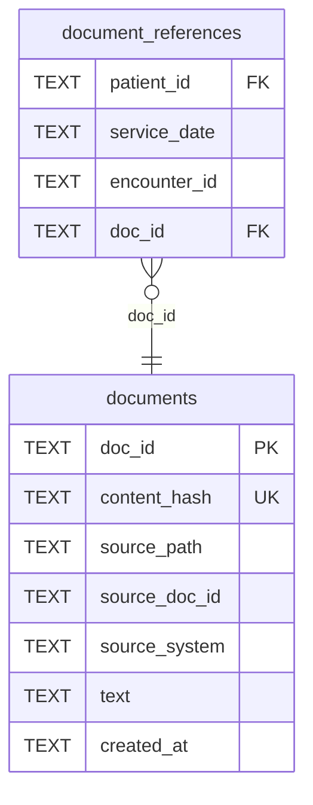

# Backbone take-home

## 1. Setup and running

Python 3.11+; run from the repository root.

```bash
python3 -m venv .venv
source .venv/bin/activate
python -m pip install -r requirements.lock.txt
export OPENAI_API_KEY="your-api-key"

# Add/update UTF-8 .txt files in documents/ beside questions.json; rerun.
python main.py "../Backbone_ Building Clinical Intelligence 09.27/questions.json"
```

Questions, with unique IDs: `[{"id": "Q1", "question": "..."}]`

| Option | Description |
| --- | --- |
| `--documents PATH` | Directory containing source documents |
| `--strategy eager\|lazy` | Processing strategy; eager default |
| `--strategy lazy --ingest-only` | Index without model calls |
| `--db PATH` | Persistent extraction cache location |
| `--response-dir PATH` | Directory for timestamped results |
| `--model NAME` | Model used for processing |
| `--effort LEVEL` | Model reasoning effort level |
| `--max-context-chars N` | Maximum question context characters |
| `--offline` | Use cached results only |
| `--refresh` | Recompute cached model outputs |
| `--help` | Show all available options |

## 2. Clinical abstraction

### 2.1 Schema

Core SQLite tables:



Text-matched headers → LLM claims → cached patient events, plans, assessments and Python-calculated totals. The patient/date index groups related evidence; `doc_id` retrieves originals for citations.

### 2.2 Benchmarks

Eager extracts and reconciles documents upfront; lazy indexes text first, then caches generic notes when questions need them. Eager is the default for lower question-time latency.

Saved result snapshots: [eager answers](results/eager-answers.json) · [lazy answers, partial](results/lazy-answers-partial.json) · [fresh lazy retry, failed](results/lazy-retry-summary.json). [Full benchmark](docs/benchmark.md#fresh-and-cached-runs) · [Recorded metrics](benchmark-results.json).

**Fresh documents — initially empty caches; 31 documents**

| Strategy | Document processing | Patient question, mean | Collection question |
| --- | ---: | ---: | ---: |
| Eager | 178.680 s | 12.723 s (5 questions) | 14.714 s |
| Lazy | 0.079 s, text indexing | Failed: HTTP 429 | Not reached |

**Cached documents and answers — exact replay**

| Strategy | Document processing | Patient question, mean | Collection question |
| --- | ---: | ---: | ---: |
| Eager | 0.053 s | 0.0075 s (5 questions) | 0.0084 s |
| Lazy | 0.187 s | 0.0084 s (2 questions) | Unavailable |

The fresh lazy retry failed on its first API request, before document parsing. Replay reuses earlier saved answers; lazy replay remains partial. The collection contains one chart patient, so cross-patient performance is unmeasured.

## 3. Approach and tradeoffs

1. **Decision:** Use eager when there is time between document upload and questions. On the same two new questions with documents already parsed, eager averaged **15.27 s** versus lazy's **22.75 s**.
2. **Limitations:** No automatic semantic correction loop: incorrect or out-of-context extractions can persist. The schema favors current question types; supporting new types may require re-extraction and more question-time LLM processing.
3. **At one million documents:** SQLite already stores data on disk; its single-writer limit constrains concurrent uploads. Our full-corpus scan would touch approximately **32,000× more documents** than this 31-document sample—an operation-count estimate, not measured latency. Replace full-corpus RAM loading with incremental intake and indexed reads; use a server database if write concurrency requires it.

**Coding assistance:** Codex assisted with design, implementation, tests and documentation; Claude assisted with PR reviews.
